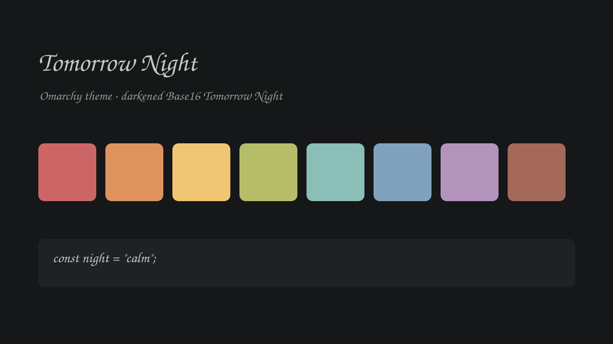

# Tomorrow Night for Omarchy

A slightly darkened take on [Base16 Tomorrow Night](https://github.com/chriskempson/tomorrow-theme)
(Chris Kempson) with a dunes-at-night wallpaper.



## Install

```bash
omarchy theme install https://github.com/rizwanreza/omarchy-tomorrow-night
omarchy theme set tomorrow-night
```

Background is `#151719` (stock Base16 is `#1d1f21`); the rest of the palette follows Base16.
Optional extras: VS Code extension `kesmarag.base16-tomorrow-night`, Neovim `RRethy/base16-nvim`.

## License

MIT. Palette © Chris Kempson (Base16 Tomorrow Night). The wallpaper was AI-generated.
